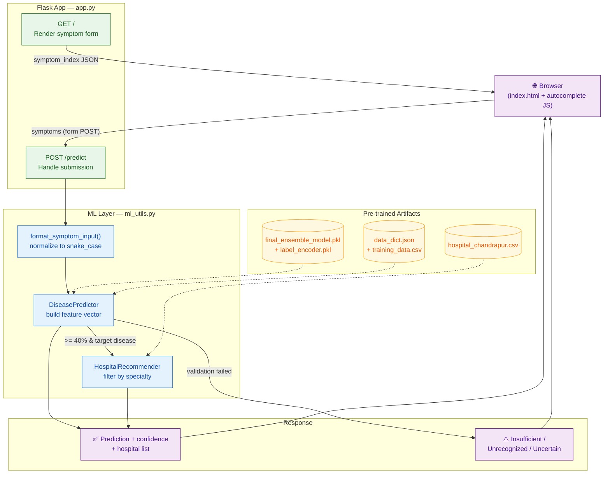

<div align="center">
  <h1>🩺 Disease Predictor 🏥</h1>
  <p><em>ML-powered disease prediction from symptoms, with nearby hospital recommendations</em></p>
  <p>
    
    
    
    
    
    
  </p>
</div>

<br>

A web application that predicts potential diseases from user-entered symptoms using a pre-trained **ensemble machine learning model**, then recommends nearby hospitals in Chandrapur suited to the predicted condition.

> [!WARNING]
> **This project is for educational purposes only.** It is **not** a medical device and must not be used as a substitute for professional medical advice, diagnosis, or treatment.

**[🐛 Report Bug](https://github.com/prathameshlonare/Disease-Predictor-Flask/issues)** · **[💡 Request Feature](https://github.com/prathameshlonare/Disease-Predictor-Flask/issues)** · **[🔀 Submit PR](https://github.com/prathameshlonare/Disease-Predictor-Flask/pulls)**

---

## ✨ Features

*   **Symptom-Based Prediction** — Enter symptoms as comma-separated values with live autocomplete suggestions powered by the app's symptom dictionary.
*   **Confidence-Gated Results** — Predictions below a configurable confidence threshold (default **40%**) are flagged as *Uncertain Diagnosis* instead of being reported as fact.
*   **Hospital Recommendations** — For target diseases (Dengue, Malaria, Typhoid), recommends up to 3 hospitals from Chandrapur filtered by medical specialty.
*   **Input Validation** — Requires a minimum of **7** recognized symptoms; unrecognized symptoms are reported back to the user.
*   **Smart Suggestions** — The full symptom vocabulary is injected into the page as JSON, so autocomplete works instantly without extra API calls.
*   **Graceful Failure** — Missing model/data files are caught at startup with clear log messages; the app refuses to run rather than serving broken predictions.

---

## 🏗️ Architecture



**Prediction flow:**

1. User types symptoms → JavaScript autocomplete suggests from the symptom dictionary → form POSTs to `/predict`.
2. `format_symptom_input()` normalizes input (`"High Fever"` → `high_fever`).
3. `DiseasePredictor` encodes symptoms into a binary feature vector aligned with the training columns.
4. The ensemble model returns `predict()` + `predict_proba()`; the label encoder maps the class back to a disease name.
5. Results are checked against `MIN_SYMPTOMS`, `CONFIDENCE_THRESHOLD`, and `TARGET_DISEASES`.
6. If the disease is a target, `HospitalRecommender` filters `hospital_chandrapur.csv` by specialty and returns up to 3 matches.
7. The same template re-renders with results, warnings, or an error message.

---

## 🛠️ Tech Stack

| Layer | Technology |
|---|---|
| Frontend | HTML5, CSS3, vanilla JavaScript (autocomplete, loading spinner, collapsible sections) |
| Icons | Font Awesome 6 (CDN) |
| Backend | Python, Flask |
| Machine Learning | scikit-learn (ensemble model), pandas, numpy |
| Serialization | `pickle` (model, label encoder), `json` (symptom dictionary) |
| Data | CSV (training data, hospital directory) |

---

## 🚀 Quickstart

### Prerequisites

*   Python **3.10+**
*   `pip`

### Installation

```bash
git clone https://github.com/prathameshlonare/Disease-Predictor-Flask.git
cd Disease-Predictor-Flask

python -m venv venv
source venv/bin/activate        # Windows: venv\Scripts\activate

pip install flask pandas scikit-learn numpy
```

### Run

```bash
python app.py
```

Then open **http://127.0.0.1:5000/** in your browser.

> The app loads the model and data files at startup. If any required artifact is missing or corrupt, it logs an explicit error and exits — check the console output first if the server doesn't start.

---

## 💻 Usage

1.  Start typing a symptom — pick suggestions from the autocomplete dropdown (they're added as chips).
2.  Add **at least 7** recognized symptoms.
3.  Click **Predict Disease**.
4.  Read the result:

| Status | Meaning |
|---|---|
| ✅ `Prediction Successful` | Disease predicted with confidence ≥ 40%; hospitals listed for target diseases |
| ⚠️ `Insufficient Data` | Fewer than 7 symptoms provided |
| ⚠️ `Unrecognized Symptoms` | None of the entered symptoms match the training vocabulary |
| 🟡 `Uncertain Diagnosis` | Confidence below 40% — consult a healthcare professional |
| ❌ `Error` | Model failed to load or an internal error occurred |

---

## 📁 Project Structure

```
Disease-Predictor-Flask/
├── app.py                    # Flask app: routes, config, startup checks
├── ml_utils.py               # DiseasePredictor, HospitalRecommender, input formatting
├── final_ensemble_model.pkl  # Pre-trained ensemble classifier
├── label_encoder.pkl         # Encodes/decodes disease labels
├── data_dict.json            # Symptom → column index map + class list
├── training_data.csv         # Feature column reference (schema)
├── hospital_chandrapur.csv   # Hospital directory (name, address, contact, specialties)
├── templates/
│   └── index.html            # Single-page UI: form + results (Jinja2)
├── static/
│   ├── css/style.css         # Styling, collapsible sections, spinner
│   └── js/script.js          # Autocomplete, symptom chips, loading state
└── README.md
```

---

## ⚙️ Configuration

All knobs live at the top of [`app.py`](app.py):

| Constant | Default | Purpose |
|---|---|---|
| `MIN_SYMPTOMS` | `7` | Minimum symptoms required for a prediction |
| `TARGET_DISEASES` | `["Dengue", "Malaria", "Typhoid"]` | Diseases the model is trained for; only these trigger hospital recommendations |
| `CONFIDENCE_THRESHOLD` | `40.0` | Minimum probability (%) for a confident result |
| `HOSPITAL_DATA_PATH` | `hospital_chandrapur.csv` | Hospital directory; point this at another city's CSV to change recommendations |

---

## 🤝 Contributing

Contributions are welcome!

1.  Fork the repository
2.  Create a feature branch (`git checkout -b feature/amazing-feature`)
3.  Commit your changes (`git commit -m "Add amazing feature"`)
4.  Push to the branch (`git push origin feature/amazing-feature`)
5.  Open a Pull Request

Please open an issue first for large changes so we can discuss the direction.

---

## 👥 Team

Questions or suggestions? Reach out:

*   [prathameshlonare9@gmail.com](mailto:prathameshlonare9@gmail.com)
*   [swapnilkumbhare706@gmail.com](mailto:swapnilkumbhare706@gmail.com)
*   [suyogmadavi12@gmail.com](mailto:suyogmadavi12@gmail.com)
*   [mohaktalodhikar@gmail.com](mailto:mohaktalodhikar@gmail.com)

---

<p align="center">
  Made with ❤️ for learning ML + Flask
</p>
